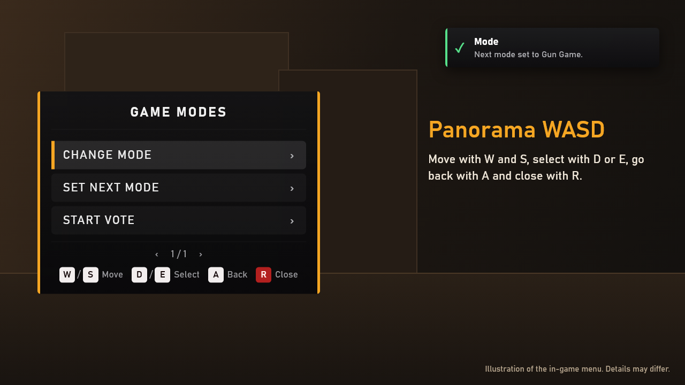
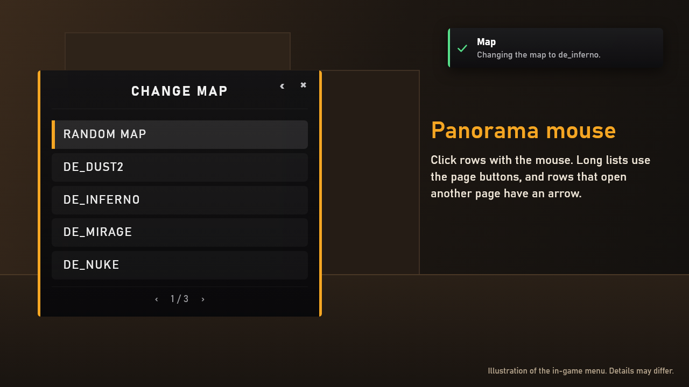
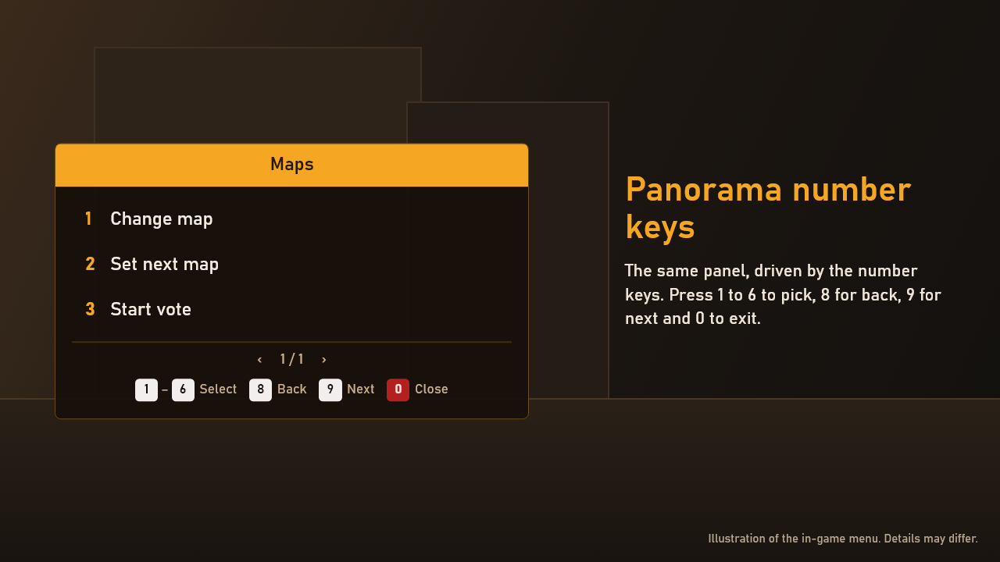
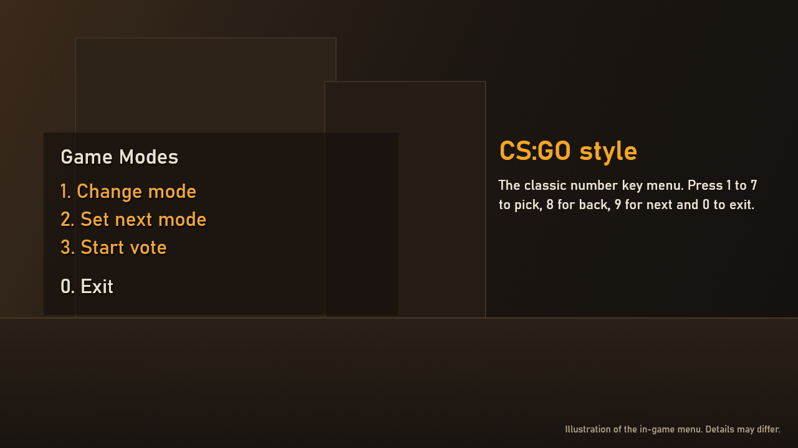
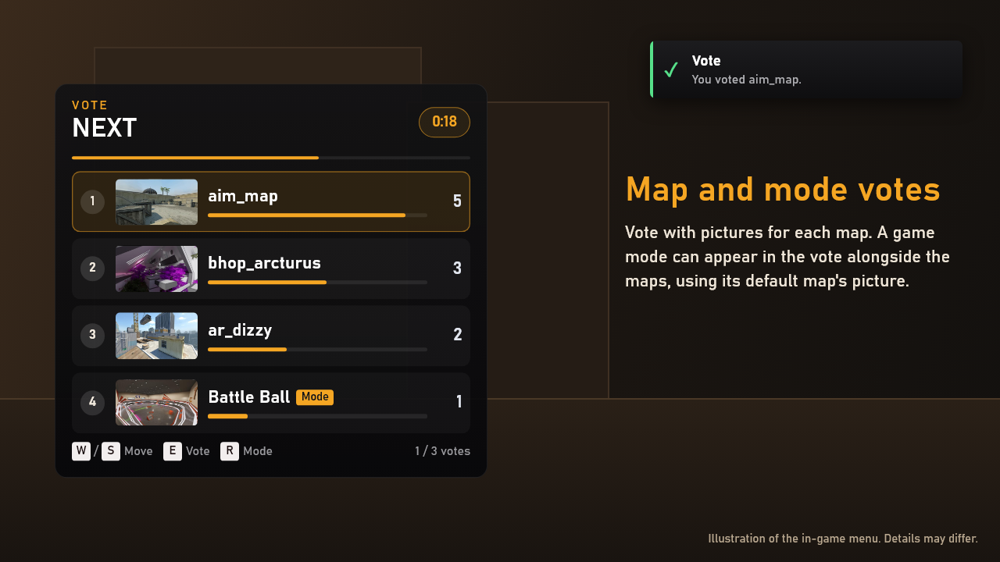
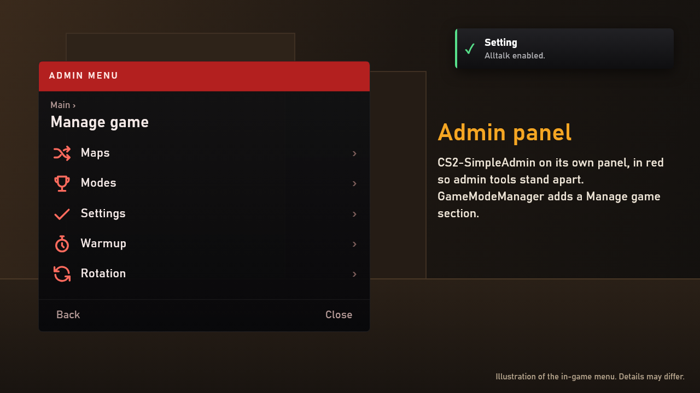
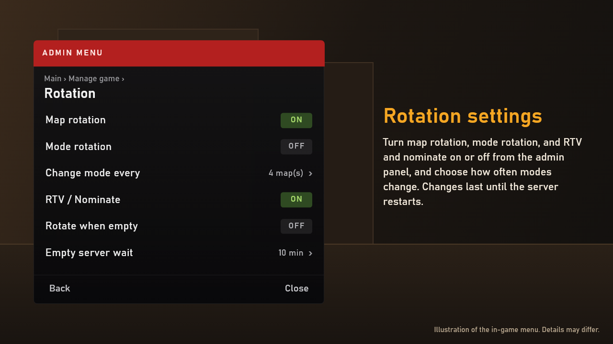

     

# GameModeManager
A Counter-Strike 2 server plugin to help administrators manage custom game modes, settings, and map rotations. 

Inspired by [CS2 Modded Dedicated Server by Kus](https://github.com/kus/cs2-modded-server) and the [CS2 Rock The Vote plugin by Abnerfs](https://github.com/abnerfs/cs2-rockthevote).

## Description
Tired of manually managing game modes, settings, and maps?

GameModeManager simplifies server administration for Counter-Strike 2 by providing:

- **Admin menus** for modes, maps, settings and warmup. If [CS2-SimpleAdmin](https://github.com/daffyyyy/CS2-SimpleAdmin) is installed, its admin menu gets them too (optional).
- **Customizable rotation** of maps and game modes, with mode schedules.
- **Player voting** for settings and game modes.
- **Per-mode map pools** for [GG1MapChooser](https://github.com/ssypchenko/GG1MapChooser): RTV, nominate and map votes only offer the current mode's maps.
- **Shared API** for cross-plugin development and integration.
- **Customization options** for rotation schedules, commands, voting styles, and languages.

This plugin is perfect for servers with a variety of custom content or those that want to give players more control over their experience.
  
## Enjoying the plugin?
Please drop a ⭐ star in the repository

## Credits
This plugin utilizes the [GameLoop.Vdf library](https://github.com/shravan2x/Gameloop.Vdf/) (licensed under the [MIT License](https://github.com/shravan2x/Gameloop.Vdf/blob/master/LICENSE)) for parsing the `gamemodes_server.txt` file, which is in [Valve Data Format](https://developer.valvesoftware.com/wiki/VDF).

Player votes (`!changemode`, `!changesetting`) are built in since 2.0.0: a PanoramaMenu Yes/No menu, or the game's own F1/F2 vote panel (`Votes.Style: "native"`, adapted from [GG1MapChooser](https://github.com/ssypchenko/GG1MapChooser)'s PanoramaVote, MIT). Earlier versions used the [CS2-CustomVotes](https://github.com/imi-tat0r/CS2-CustomVotes) plugin, which is no longer needed.

Vote settings (`Votes` in `GameModeManager.json`): `Enabled`, `GameModes`, `GameSettings`, `Style` (`menu` | `native`), `Percentage` (yes votes needed, % of eligible players, default 51), `Duration` (seconds, 30), `MinPlayers` (1), `Cooldown` (seconds before the same player can start another vote, 60), `AllowSpectators` (false), `AllowInWarmup` (false). One vote runs at a time, and none starts while a GG1MapChooser map vote is running.

For creating menus, this plugin utilizes the [PanoramaMenuManager](https://github.com/RRimmer/PanoramaMenuManagerCS2) shared plugin API (`MenuManagerApi`, capability `menu:nfcore`). Versions before 2.0.0 used [MenuManagerAPI](https://github.com/Nickj609/MenuManagerAPI).

Lastly, a special thanks to the [CS2 Rock The Vote plugin by Abnerfs](https://github.com/abnerfs/cs2-rockthevote). The plugin's use of the dependency injection framework served as the core architecture for the development of this plugin.

## Menus
GameModeManager's menus use [PanoramaMenuManager](https://github.com/RRimmer/PanoramaMenuManagerCS2), so they look like part of the game. Each player picks the style they like by typing `!menu`, and the server remembers it. Players don't need to install anything: the game downloads the menu files when they join.

| Panorama WASD | Panorama mouse |
| :-: | :-: |
|  |  |
| Move with `W` and `S`, select with `D` or `E`, go back with `A` and close with `R`. | Click a row to select it. Long lists have page buttons at the bottom. |

| Panorama number keys | CS:GO style |
| :-: | :-: |
|  |  |
| Press `1` to `6` to select, `8` for back, `9` for next and `0` to close. | The classic number key menu. Press `1` to `7` to select, `8` for back, `9` for next and `0` to exit. |

Number key styles need the number keys bound once. When a player picks one, a short check walks them through it. `!menu` also has center-screen and chat styles.

The pictures in this README are illustrations, so details may differ slightly in-game.

## Map and Mode Votes
Players choose what to play next with [GG1MapChooser](https://github.com/ssypchenko/GG1MapChooser), which comes with GameModeManager.

- **Rock the vote:** type `!rtv` to ask for a new map. When enough players agree, a vote starts.
- **Nominate:** type `!nominate` and choose **Map** or **Mode** to suggest something for the next vote. One mode can be nominated at a time, and maps that aren't available are greyed out.
- **End-of-map vote:** a vote starts by itself near the end of a match, and it can offer more time on the current map.
- **Only the right maps:** votes and nominations only list maps from the current game mode, so a surf server won't offer a competitive map.
- **Change the mode by vote:** one other game mode can appear in the vote beside the maps, and if it wins, the server changes to it. Votes can also choose a map at random from the current mode.
- **Quick yes/no votes:** type `!changemap` or `!changemode` to pick from a list, or add a name to vote on it straight away, like `!changemode Gun Game`.
- **Handy commands:** `!nextmap` shows what's next, `!timeleft` shows the time remaining, and `!game` puts these all in one menu.

Admins can start a random vote or a yes/no vote from **Start vote** in `!maps`, `!modes` and the admin menu.

Setup notes for server owners

 

GG1MapChooser is **required** since 2.0.0: it picks the maps, and GameModeManager picks the mode and decides when the map changes. GameModeManager 1.0.x had its own RTV and map menus, so stay on 1.0.x if you need those.

- **Map lists:** GameModeManager builds one map list per mode from your map groups in `cfg/GGMCmaps.tuning.json`. Change `weight`, `minplayers` and `maxplayers` there and your changes are kept. GG1's own pool vote can't be used with this.
- **Settings:** `MapChooser.Rtv` turns `!rtv` off, and end-of-map votes and rotations keep working. For one mode, add `css_mapvote_rtv false` to its `<mode>_settings.cfg`. In `GameModes.List`, a mode's `InVotes: false` keeps it out of votes, `!nominate`, `!changemode` and random picks, and `InRotation: false` keeps it out of mode rotation. Admins and schedules can still choose it. `MapChooser.ModesInVotes` turns modes in votes off. `MapChooser.TriggerSecondsBeforeEnd` (default 60) and `TriggerKillsBeforeEnd` (default 13) set when the end-of-map vote starts on time-limited matches and arms race.
- **Map changes:** at the end of a match, GameModeManager changes to the winning map, or a random one if nobody voted, after a short countdown. With `Rotation.Enabled: false` it leaves the map alone. If nobody votes, the random pick can also land on the mode in the vote.
- **Keep these GG1 settings:** the included config turns off `ChangeMapAfterWinDraw`, `ChangeMapAfterTimeLimit`, `RandomMapOnStart` and `LastDisconnectedChangeMap` so only GameModeManager changes the map, and uses the `wasd` menus the bridge needs.
- **GG1 updates:** GG1 isn't modified. A few features read its internals and log a warning or do nothing if an update changes them.
- **Vote panel text:** `Votes.NativeTitleToken` shows each vote's own title on the game's F1/F2 vote panel, but needs `platform_english.txt` on the server and every player's PC.
- **Changing to any map by name:** use an admin plugin like [CS2-SimpleAdmin](https://github.com/daffyyyy/CS2-SimpleAdmin)'s `!map`, or GG1's `ggmap`.

## CS2-SimpleAdmin (optional)
If you use [CS2-SimpleAdmin](https://github.com/daffyyyy/CS2-SimpleAdmin), its admin menu gets a **Manage game** section with everything in one place. Nothing else changes if you don't use it.

| Manage game | Rotation |
| :-: | :-: |
|  |  |
| Change or vote on maps and modes, turn settings on and off, and control warmup. | Turn map rotation, mode rotation and Rock the Vote on or off, and choose how often modes change. These changes last until the server restarts. |

- **Polls:** with SimpleAdmin, `!vote` asks players a question. One or two words make a yes/no vote, and with more, the first is the question and the rest are its answers: `!vote "Best map?" Mirage Inferno Nuke`.
- **To get the red panel shown here:** install the optional [PMM_SimpleAdmin](https://github.com/RRimmer/PMM_SimpleAdmin) plugin, which isn't in the zip, then restart the server fully. Its menu files are already in GameModeManager's Workshop addon, so players don't need anything extra. Without it, the same items appear in SimpleAdmin's normal menus.
- **Turning it off:** set `AdminPanel.Enabled` to `false` in `GameModeManager.json`.

## Requirements
You need these on your server already, on Windows or Linux:
- [Metamod:Source](https://github.com/alliedmodders/metamod-source/) 2.0
- [CounterStrikeSharp](https://github.com/roflmuffin/CounterStrikeSharp) **v1.0.369+** (the with-runtime build; GameModeManager 2.0.0+ targets .NET 10, so use 1.0.x on older servers)
- [MultiAddonManager](https://github.com/Source2ZE/MultiAddonManager), installed and turned on. It sends players the Workshop addon that menus need. GameModeManager adds that addon to its list by itself, and your other addons and its config stay as they are. To use your own addon instead, put its Workshop ID in `WorkshopAddon` in `GameModeManager.json` (comma-separated for several), or leave it empty to stop GameModeManager adding any. Only load one addon with these menu files: two would both replace the same files, so you can't be sure which styling players get.

Everything else is **in the release zip**, so copying it to `/csgo/` and restarting the server fully is enough:

| Included | Version | License | Purpose |
| --- | --- | --- | --- |
| [PanoramaMenuManager](https://github.com/RRimmer/PanoramaMenuManagerCS2) | 1.3.01 | GPL v3 | Menus |
| [GG1MapChooser](https://github.com/ssypchenko/GG1MapChooser) | 1.8.1 | MIT | Map votes, RTV, nominate |
| [PMM_GG1MapChooser](https://github.com/RRimmer/PMM-GG1MapChooser) | 0.1.0 | GPL v3 | Draws votes and nominate on PanoramaMenu |

Their licenses are in their folders, and the links above have their source. Their config files are set up to work together.

> [!WARNING]
> Installing replaces these plugins and their config files: `MenuManagerCore.json`, `MenuManager_Modules_Translation.json`, `GG1MapChooser.json` and `PMM_GG1MapChooser.json`. **Back them up first if you've customized them.**

## Commands

Server Commands

	
 

| Command                                       | Description                                                                                              |
| :-------------------------------------------- | :------------------------------------------------------------------------------------------------------- |
| `css_gamemode <mode>` | Sets the current mode.                                                                                   |
| `css_warmupmode <mode>` | Schedules and sets the game mode to be used during the warmup period.                                    |
| `css_endwarmup` | Ends the custom warmup mode, transitioning to the scheduled or default game mode.                        |
| `css_startwarmup <mode>` | Immediately starts a custom warmup mode with the specified mode.                                         |
| `css_timelimit <true\|false> <seconds>` | Enables or disables a time limit for the map. Optionally, you can specify the time limit in seconds.     |
| `css_mapvote_auto <true\|false>` | Turns the automatic end-of-map vote on or off for the current mode (for mode cfgs).                      |
| `css_mapvote_extend <true\|false>` | Offers "extend map" in map votes or not for the current mode (for mode cfgs).                            |
| `css_mapvote_rtv <true\|false>` | Turns `!rtv` on or off for the current mode. Put it in the mode's `<mode>_settings.cfg`. A new mode starts with it on. |
| `css_gmm_status` | Shows what GameModeManager found on the server: plugins, map list, Workshop addon and settings. Include it in bug reports. |

	

Admin Commands

 

| Command                                   | Description                                                                                                            |
| :---------------------------------------- | :--------------------------------------------------------------------------------------------------------------------- |
| `!maps` | Displays an admin menu to change to one of the current mode's maps or start a map vote.                                |
| `!modes` | Displays an admin menu to change the game mode or start a vote on one.                                                 |
| `!settings` | Displays an admin menu to enable or disable custom game settings, or start a vote on one.                              |   
| `!mode <mode name>` | Changes the game mode to the mode specified. For example, for **mg_surf** you would do **!mode surf**.                 |    
| `!warmup` | Displays an admin menu to start, schedule or end warmup.                                                               |
| `!timelimit <true\|false> <seconds>` | Sets the time limit for the current map.                                                                               |
| `!setting <enable\|disable> <setting name>` | Enables or disables a custom game setting. For example, for **enable_movement_unlock.cfg** you would do **!setting movement_unlock**. |

Player Commands

 

| Command        | Description                                                              |
| :------------- | :----------------------------------------------------------------------- |
| `!game` | Menu of player commands, including GG1MapChooser's RTV, Nominate, Next map, Time left. |
| `!currentmap` | Displays the current map.                                                |
| `!currentmode` | Displays the current game mode.                                          |
| `!menu` | Choose your menu style. |
| `!changemap` | Menu of the current mode's maps; picking one starts a yes/no vote to change to it. |
| `!changemode` | Menu of modes; picking one starts a yes/no vote to change to it.         |
| `!changesetting` | Menu of settings; pick one, then Enable or Disable, to start a vote.     |

RTV, nominate (the current mode's maps), next map and time left come from GG1MapChooser: `!rtv`, `!nominate`, `!nextmap`, `!timeleft`.

# Getting Started
> [!IMPORTANT]
> If this is your first time setting up a modded server, I highly suggest checking out the [CS2-Modded-Server Repo by Kus](https://github.com/kus/cs2-modded-server). It's a great resource for understanding how to set up custom game modes, which aren't included with this plugin. Additionally, it includes a preconfigured version of this plugin for beginners.

To get started, make sure all of the following prerequisites are met:

- All of your mode config files are located in `/csgo/cfg/`.
- Both [Metamode:Source](https://github.com/alliedmodders/metamod-source/) and [CounterStrikeSharp](https://github.com/roflmuffin/CounterStrikeSharp) are installed.
- Your `gamemodes_server.txt` or custom map group file is in [VDF Format](https://developer.valvesoftware.com/wiki/VDF) and contains a list of map groups.

## Installation
1. Download the [Latest Release](https://github.com/nickj609/GameModeManager/releases/latest). 
2. Copy the `addons` and `cfg` folders to `/csgo/`.
3. Update each game mode configuration file (i.e. comp.cfg) to include `css_gamemode <mode>`.
4. After the first run, update the configuration file `GameModeManager.json`.

For more information about the configuration of this plugin and the use of the [Shared API](https://github.com/nickj609/GameModeManager/wiki/Shared-API), see our [Wiki](https://github.com/nickj609/GameModeManager/wiki).

# Need Help?
If you have a question, check out our [FAQ](https://github.com/nickj609/GameModeManager/wiki/FAQ-(Frequently-Asked-Questions)) and if you still need help, [create a new issue](https://github.com/nickj609/GameModeManager/issues/new/choose).
